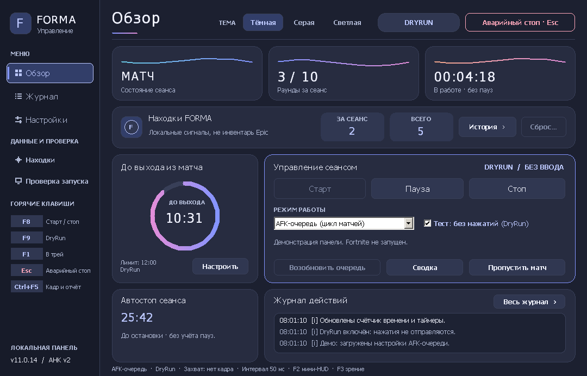

# FORMA

Экспериментальная визуальная автоматизация для Fortnite на AutoHotkey v2. Распознавание работает на встроенном анализе пикселей кадров окна. FORMA не читает память игры и не внедряет в неё код. Автоматизация может нарушать правила игры и привести к санкциям.

**v11.0.13** поддерживает «Авто-игру», «AFK-очередь», «Анти-АФК» и «AFK XP».

## Скачать для Windows x64

[**Скачать FORMA v11.0.13 для Windows x64 (.zip)**](https://github.com/Doxaiz/Fortnite-test-bot/releases/download/v11.0.13/FORMA-v11.0.13-windows-x64.zip) · [SHA256SUMS.txt](https://github.com/Doxaiz/Fortnite-test-bot/releases/download/v11.0.13/SHA256SUMS.txt) · [Актуальный релиз](https://github.com/Doxaiz/Fortnite-test-bot/releases/latest)

Если загрузка из **Assets** недоступна, возьмите [тот же ZIP](https://github.com/Doxaiz/Fortnite-test-bot/raw/refs/tags/v11.0.13/portable/FORMA-v11.0.13-windows-x64.zip) и [его контрольную сумму](https://github.com/Doxaiz/Fortnite-test-bot/blob/v11.0.13/portable/SHA256SUMS.txt) из тега `v11.0.13`.

В `portable/` хранится только текущий ZIP. [История релизов](https://github.com/Doxaiz/Fortnite-test-bot/releases) содержит ссылки на ZIP и контрольные суммы прежних версий. Пункты **Source code** — архивы исходников, а не готовая программа.

Для проверки ZIP откройте PowerShell в папке загрузки:

```powershell
Get-FileHash -LiteralPath .\FORMA-v11.0.13-windows-x64.zip -Algorithm SHA256
```

Сравните `Hash` с суммой для этого ZIP в `SHA256SUMS.txt`. Регистр букв не важен. Если суммы не совпадают, не запускайте `FORMA.exe`.

Распакуйте архив в обычную папку с правом записи и запустите `FORMA.exe`. Установщика нет, AutoHotkey уже встроен. `forma.ini` и `run.log` хранятся рядом с EXE. Закройте другие экземпляры FORMA перед запуском. Исходный `.ahk` тоже можно запустить через AutoHotkey v2.

### Обновление с сохранением данных

1. Закройте старую FORMA через **«Выход»** в трее и сделайте копию её папки.
2. Распакуйте новый ZIP в отдельную папку. Скопируйте из старой папки `forma.ini`, `run.log`, `run.log.prev`, `ЖЕТОН_НАЙДЕН.txt` и `macro.txt`, если эти файлы есть. Не переносите `run.log.resume`: это служебный флаг автоматического возобновления.
3. Запустите новый `FORMA.exe`. Перед стартом сеанса проверьте режим, DryRun, назначенные клавиши и счётчики. Старую папку не удаляйте, пока не убедитесь, что всё на месте.

## Главная панель

Панель FORMA — отдельное окно с боковым меню и тёмной, серой и светлой темами. Это интерфейс самого `fortnite_bot.ahk`, не отдельный лаунчер. Тема меняется без перезапуска и хранится в `forma.ini` (`[ui]`, `theme`); по умолчанию она тёмная.



*Снимок панели v11.0.11 с демонстрационными данными, без запуска Fortnite.*

- **Обзор** — состояние, раунды и активное время сеанса, режим и **DryRun**, «Старт», «Пауза», «Стоп», возобновление очереди, последняя строка журнала и диагностика. Круговой таймер показывает настроенный лимит, а в матче — время до его достижения. Лимит относится к режимам «Авто-игра» и «AFK-очередь»; `0` означает, что автовыход по времени отключён. Общая пауза не меняет расчёт времени движком.
- **Настройки** — ползунки и числовые поля для лимита матча, задержки в лобби, автостопа и лимита раундов. **«Сохранить таймеры»** применяет эти четыре значения после остановки сеанса. Блок **«Координаты мыши и экран»** показывает X/Y для разных размеров клиентской области и не меняет сохранённые точки. Для редактирования точек, других опций AFK, XP, маршрута, Discord и клавиш открываются прежние диалоги.
- **Журнал** — до 300 последних событий текущего запуска. **«Очистить экран»** убирает строки из окна, не удаляя `run.log`. **«Кадр и отчёт»** вызывает ту же диагностику, что Ctrl+F5, с теми же ограничениями.
- **Находки** — счётчики за сеанс и за всё время и до 80 последних строк из `ЖЕТОН_НАЙДЕН.txt` (из последних 48 КиБ), новые сверху. Это локальные сигналы, в том числе редкие баннеры и события DryRun, **не инвентарь Epic**. Подтверждённый сброс на обзоре обнуляет только два счётчика находок после остановки и оставляет историю и статистику раундов.
- **Проверка запуска** (с v11.0.12) — разрядность и тип сборки (`EXE` или `.ahk`), Windows и DPI, DryRun, наличие окна игры и локальных файлов, регистрация клавиш. Это сводка состояния, а не тест захвата или ввода. «Обновить» перечитывает состояние, «Найти run.log» выделяет файл в Проводнике, «Скопировать» копирует текст без путей, настроек Discord и содержимого журнала. Сводка ничего не отправляет.

**Аварийный стоп** доступен на всех страницах. Возобновление очереди не снимает общую паузу. Ярлыки в боковом меню берутся из настроек FORMA; по умолчанию F8 — старт/стоп, F9 — DryRun, F1 — скрыть/показать окно без остановки. Закрытие окна останавливает сеанс и скрывает панель в трей. Игровой цикл и горячие клавиши не переназначены.

## Запуск и проверка

1. Для **чистого запуска** распакуйте переносимый ZIP (или скопируйте `fortnite_bot.ahk`) в отдельную папку без прежнего `forma.ini`. Если хотите сохранить настройки, используйте [порядок обновления](#обновление-с-сохранением-данных) выше.
2. Запустите `FORMA.exe` или исходный `.ahk` через AutoHotkey v2. Откройте **«Проверка запуска»** и проверьте версию `FORMA v11.0.13`, включённый **DryRun** и наличие `run.log`. В новой папке сеанс не начинается автоматически, а без открытой игры сообщение об отсутствии окна Fortnite нормально. При смене DryRun во время работы скрипт ставится на паузу; продолжение ручное.
3. В Fortnite используйте режим «Оконный без рамки», не сворачивайте окно. Для проверки сундука наведите игровой прицел на доступный сундук так, чтобы появилась плашка взаимодействия. Проверьте захват с F7 и распознавание на отдельном снимке с F5. Затем запустите цикл с F8 в DryRun. В `run.log` можно увидеть ожидание второго кадра и `удерживал бы E … мс`. Скрипт ожидает привязку взаимодействия к **E**. Esc — аварийный стоп; F6 — отдельный тест мыши.
4. Автобой доступен только в «Авто-игре» в активном окне. Режим «Команда» оставляет бой игроку: цвет и движение не различают союзников надёжно. В DryRun выстрелов и движений нет даже при найденном кандидате.
5. Если проблема именно с запуском, пришлите скопированную сводку и свежую строку `=== Запуск: FORMA …` с ближайшими ошибками из `run.log`. Перед отправкой проверьте, нет ли в журнале личных данных. Если панель не открывается и журнала нет, укажите точный текст сообщения Windows и откуда запущен EXE (из распакованной папки или из ZIP).
6. Если проблема с распознаванием в игре, нажмите **Ctrl+F5** с видимой плашкой, чтобы сохранить кадр и отчёт с него. Также полезны ближайшие записи `[prompt-late]` / `[combat-late]` / `[input]` / `[perf]` из `run.log`, а для F4 — `[leave]`. `[perf]` показывает время этапов по часам, включая ожидание; это не FPS и не загрузка CPU.

## Поиск фигур со статичным прицелом (v11.0.9)

- **Декорация больше не скрывает движение в проверенном сценарии.** Скан перепроверяет плотность тёплой маски внутри выбранной рамки без пустых краевых строк и столбцов. Слишком плотное пятно отбрасывается, после чего проверяется локальное движение. На тестовых кадрах это позволяет найти движущуюся фигуру рядом с неподвижной опорой. В F5 есть причина `рамка растянута фоном`.
- **Цвет прицела не определяет цель.** Движение оценивается по отдельным участкам: далёкая вспышка не раздувает рамку фигуры. В **F3 «Зрение»** голубая рамка — первый кандидат, красная — повтор на свежем кадре. `Бой не сканировался` — не то же самое, что пустой результат.
- На открытом игровом снимке ложная рамка на опоре исчезла, но статический скан по-прежнему не увидел неподвижную фигуру в центре. [Как работает встроенный скан и как проверить свой кадр](docs/enemy-vision.md). Рамка не подтверждает, что найден именно противник.

## Боевой скан (v11.0.7)

- Просроченный или прерванный скан не обновляет подтверждение цели и не запускает новый интервал ожидания. При просрочке бой не останавливает текущий отрезок и не сбрасывает проверку после E. Допуск кадра **0–250 мс**, проверка окна/камеры/поколения ввода и защита командного режима не менялись.
- Поиск фигуры и движения на синтетических парах 720p и 1080p занял **на 38–63% меньше времени**. Результаты сопоставлены с v11.0.6 на 180 парах; пороги прежние. Это время детектора, не время тика и не FPS игры. [Воспроизведение сбоя, замеры и диагностика](docs/combat-scan.md).

## Подсказка E (v11.0.6)

- Скан проходит по тем же пикселям с прежними порогами. В замере на синтетических кадрах он занял на **17–25% меньше времени** относительно v11.0.5. [Замеры и команда для повторения](docs/prompt-scan.md).
- После скана ещё раз проверяется актуальность кадра. Если он устарел или сменились окно, камера либо поколение ввода, замер не обновляет кэш и не останавливает обычный ход как кандидат на E. Цикл ждёт новый кадр, не передавая старый в следующую ветку. В журнале это видно по `[prompt-late]`.
- Два похожих наблюдения на разных свежих кадрах по-прежнему обязательны. Плашка — не распознанный текст и не доказательство открытия сундука. Контроль фокуса, отпускание клавиш, время удержания E и пороги боя не менялись.

## Поиск кнопок лобби (v11.0.5)

- «Играть» и «Отменить» в общей нижней левой области ищутся одним проходом. Сохранены и широкий поиск для других раскладок, и порядок кнопок справа на итогах. Пороги, интервалы сканов, исходы очереди и порядок F4 не менялись. Для действия по плашке по-прежнему нужен полный скан текущего кадра.
- В замере полного `FrameMenu` на одинаковых синтетических буферах 1280×720 и 1920×1080 время уменьшилось на **27–30%** относительно v11.0.4 (AHK v2 под Wine). Это время детектора, не FPS игры. [Замеры, повторяемый тест и разбор Pirate Token Farm и других примеров](docs/afk-examples.md).

## Кадр и отчёт (с v11.0.4)

- **Ctrl+F5** или пункт «Сохранить кадр и отчёт» в трее работает на паузе, в DryRun или после остановки FORMA. Для проверки плашки удобнее нажать клавиши прямо в игре. В боевом режиме без паузы запись не начинается.
- Из одного захвата получаются два файла с общим именем: `.bmp` с исходными пикселями клиентской области и `.txt` с версией, источником захвата и отчётом F5. Папку можно открыть через Win+R → `%TEMP%\FORMA-diagnostics`. Автоматического сохранения или отправки нет. Перед отправкой проверьте, что кадр не содержит личных данных.
- Обычная **F5** по-прежнему выводит диагностику без снимка. Диагностический кадр не заменяет кадр рабочего цикла и не подтверждает возможность нажатия E.
- `tools/replay_f5.ahk` повторяет отчёт F5 по сохранённому BMP с настройками сборки по умолчанию, без Fortnite, захвата или ввода. [Как повторить отчёт по своему кадру](docs/f5-replay.md).

Отчёт помогает отделить ошибку распознавания от случая, когда детектор нашёл кандидата, но ввод не разрешён. [Как читать пару BMP и TXT](docs/afk-examples.md#что-проверять-по-следующей-паре).

## Что изменилось в v11.0.3

- **Пропажа кадра или смена фокуса.** Когда цикл «Авто-игры» или «AFK-очереди» замечает сворачивание, потерю изображения, смену окна или фокуса, он отпускает удерживаемые клавиши и сбрасывает подтверждения целей. Фоновые клавиши отпускаются в исходном окне; старый таймер не обрывает новое удержание. В журнале переход отмечен `[input]`.
- **Возврат без перезапуска матча.** Сброс ввода сам по себе не меняет сцену, таймер матча или исход очереди. Действия возобновляются по новому кадру, а для E снова нужны две похожие подсказки. «Фон-клавиши» по-прежнему работают только в окнах, принимающих сообщения клавиатуры; для автобоя нужен активный клиент.

## Сундуки, бой и движение (v11.0.2)

- **Сундуки и лут.** Подход использует центр найденного пятна, а не поля рамки. Близость пятна к прицелу не считается доказательством, что сундук в зоне действия: скрипт сначала ждёт плашку, затем при необходимости пробует короткий шаг. При включённых сундуках две похожие подсказки на свежих кадрах одного вида разрешают настроенное удержание E (по умолчанию 580 мс), даже если свечение уже не видно. Текст и тип объекта не читаются. Клавиша отпускается таймером. Попытка E и исчезновение плашки не считаются открытием, не увеличивают старый счётчик сундуков и не запускают слепой подбор. Сессия отдельно показывает **попытки E**.
- **Бой.** Фигура и движение проходят проверку; цифры урона и метки звука не становятся целями. Убраны повторный поиск цифр до наведения и дополнительный широкий проход на том же кадре. Выстрел требует кандидата на текущем кадре того же окна, без поворота после захвата и при допустимой ошибке наведения. Эти детекторы эвристические и не гарантируют распознавание всех игроков или попадания.
- **Движение.** За кадр выбирается одна ветка действий: бой, взаимодействие, подход или обзор. Патруль и выравнивание не перебивают ожидание подсказки или боя. A/D и направленный шаг ограничены по времени, а старый таймер не отпускает новое удержание. Золотая метка звука влияет на подход только после нового замера. Из обхода препятствий убраны слепые E и удары киркой.

## Что сохранилось из v11.0.1

- **HUD, кнопки и очередь.** HP и признаки HUD относятся к одному снимку. Отсрочка скана — не отрицательное наблюдение. Недавний HUD удерживает только уже принятую сцену матча; старый контур кнопки не даёт клик. Кремовая плашка «Отменить» блокирует «Играть»; после возможной ручной отмены поиск продолжается вручную.
- **F4 — пропуск матча.** Шаги выполняются в матче и на экране устранения. После Esc нужен следующий кадр. Настроенная точка вкладки выхода — единственный координатный шаг, остальное ищется по текущим кадрам. Без распознанного подтверждения скрипт не кликает наугад. Раунд учитывается только после обнаружения лобби. Смена окна, ошибка ввода и тайм-аут прерывают выход. В DryRun F4 только описывает шаги. По старому журналу нельзя установить, откуда пришёл `СТОП (Esc)`; аварийный хоткей не отключается во время выхода.

## Автоматические проверки

- `tests/runtime_diagnostics.ahk`: **30 групп** синтетических проверок HUD, меню, сундуков, подсказок и боя, приоритетов, таймеров, F5, экспорта, очереди и F4. Проверки плашки E сравнивают геометрию на пяти размерах, а также просрочку, смену вида и прерывание во время скана. Боевой скан проверяется с теми же сбоями во время чтения и на эталонных буферах фигуры и движения, в том числе с плотным фоном и статичным прицелом. Общий проход кнопок проверяется на четырёх размерах. Интерфейс и хоткеи не запускаются.
- `tests/window_input.ahk`: **6 проверок** с двумя окнами отдельного процесса. Рабочий цикл захватывает их кадры 480×288; приёмники считают реальные `WM_KEYDOWN` / `WM_KEYUP` для E и W. Проверяются удержание E после двух кадров, отпускание W при сворачивании, перенос на другое окно без вмешательства старого таймера, сброс подтверждения при реальной смене фокуса, два замера движения на фоне опоры при неизменном цвете прицела в DryRun (включая F3 и отчёт F5) и сохранение диагностического кадра GDI. Тест временно переключает фокус; запускайте на видимом рабочем столе и не переключайте окна до завершения. Тестовые окна закрываются автоматически; настройки FORMA не меняются.

- `tests/replay_f5.ahk`: чтение BMP без изменения пикселей, отказ на повреждённых файлах, совпадение отчёта до и после экспорта, обработка пакета и изоляция от игрового цикла.
- `tests/main_panel.ahk`: **8 групп** проверок: навигация, журнал, темы, безопасная запись таймеров, предпросмотр координат, круговой таймер, история и сброс находок, управление сеансом, сводка запуска и резервная панель. Сводка проверяется на копирование без путей и содержимого журнала и обновление без записи файлов. Тест требует видимый рабочий стол, не запускает Fortnite или рабочий цикл и не назначает глобальные горячие клавиши.

Запуск этих четырёх наборов из корня репозитория в PowerShell:

```powershell
$ahk = "$env:ProgramFiles\AutoHotkey\v2\AutoHotkey64.exe"
foreach ($suite in 'runtime_diagnostics', 'window_input', 'replay_f5', 'main_panel') {
    $p = Start-Process $ahk -ArgumentList "/ErrorStdOut=UTF-8 tests\$suite.ahk" -NoNewWindow -Wait -PassThru
    if ($p.ExitCode -ne 0) { throw "Ошибка теста: $suite" }
}
```

В актуальном Fortnite обновление не проверялось. Тестовые плашка, прицел и движение нарисованы, а фоновый ввод подтверждён только тестовыми окнами. Это не проверка открытия сундука, точности распознавания реальных игроков или доставки ввода в игре. Загруженный ранее `run.log` относится к v10.0, а не к этой сборке.

## Сборка переносимого EXE

На Windows запустите из корня репозитория в PowerShell:

```powershell
.\tools\build-portable.ps1 -SmokeTest
```

Скрипт проверяет SHA-256 загруженных архивов Ahk2Exe и AutoHotkey и ничего не устанавливает. В `dist/portable` получаются ZIP с `FORMA.exe` и лицензиями, отдельный ZIP исходников встроенного AutoHotkey v2.0.18 (GNU GPL v2) и `SHA256SUMS.txt`. Исходники FORMA остаются под MIT.

`-SmokeTest` запускает **EXE из собранного ZIP** в двух временных папках: без настроек и с синтетическим профилем формата v11.0.11. Проверяются панель, DryRun и сводка, а при обновлении — загрузка режима, таймеров, клавиш и статистики, а также сохранность профиля, журналов, истории находок и маршрута после штатного выхода. Тест проверяет регистрацию клавиш по журналу, не нажимая их. Если ZIP текущей версии есть в `portable/`, тест сверяет его SHA-256 и повторяет оба запуска с ним. Личные файлы не используются.

Для теста нужен видимый рабочий стол; не запускайте Fortnite или другие экземпляры FORMA. Для сборки без запуска EXE уберите `-SmokeTest`. Готовый ZIP можно проверить отдельно, передав путь к распакованному `FORMA.exe` в `tests/portable_startup.ahk` через AutoHotkey v2.

### Подготовка релиза по тегу

[Portable Windows build](https://github.com/Doxaiz/Fortnite-test-bot/actions/workflows/portable.yml) работает на Windows при pull request в `main`, после изменений в `main`, при отправке тега `vX.Y.Z` и вручную. Изменение одного только номера тега не меняет версию приложения. В прогонах без тега или `expected_tag` CI проверяет отказ на неверном номере, а затем собирает и тестирует ZIP с номером из `Ahk2Exe-SetVersion`. Эти проверки не создают тегов.

1. Перед новым релизом обновите `FORMA_VERSION` и директиву `Ahk2Exe-SetVersion` в `fortnite_bot.ahk` (`X.Y.Z` и `X.Y.Z.0`). Для проверки без создания тега выберите **Run workflow**, нужную ветку и укажите `expected_tag` (например, `v11.0.13` для текущих исходников). Можно проверить версию локально командой `.\tools\build-portable.ps1 -SmokeTest -ExpectedTag v11.0.13`.
2. После проверки отправьте тег `vX.Y.Z` на проверенном коммите. При несовпадении тега и `FORMA_VERSION` сборка остановится **до загрузки зависимостей**. При успехе на странице прогона появится артефакт `FORMA-vX.Y.Z-windows-x64` (на обычных прогонах без тега — `FORMA-portable-windows-x64`, срок хранения — 14 дней).
3. Скачайте и распакуйте артефакт. Для черновика релиза вручную прикрепите **из одного прогона** три файла: ZIP с `FORMA.exe`, ZIP с исходниками AutoHotkey и `SHA256SUMS.txt`. Проверьте суммы ZIP (`Get-FileHash *.zip -Algorithm SHA256`) и опубликуйте релиз вручную. Если публикуете ZIP из `portable/` ссылкой в описании релиза, берите и ZIP, и `SHA256SUMS.txt` из тега этого выпуска, а не из `main`. Workflow не создаёт релизов и не меняет уже опубликованные архивы.

### Файлы в разделе Assets

Для уже опубликованного **Latest** можно вручную запустить [Attach portable assets](https://github.com/Doxaiz/Fortnite-test-bot/actions/workflows/attach-portable-assets.yml). В **Run workflow** выберите `main`, укажите `release_tag` (например, `v11.0.13`) и отметьте `attach`, если нужно прикрепить файлы. Без отметки workflow только проверяет архив и сообщает, каких вложений не хватает.

Workflow берёт ZIP и `SHA256SUMS.txt` из коммита указанного тега, проверяет контрольную сумму и целостность ZIP и прикрепляет только недостающие файлы. Совпадающие вложения остаются на месте, а при другом или неизвестном хэше запуск остановится без замены. Новые релизы и теги не создаются; публикация релиза остаётся ручной.

## Лицензия

Исходники FORMA — [MIT](LICENSE). Лицензия встроенного AutoHotkey указана в переносимом архиве.
