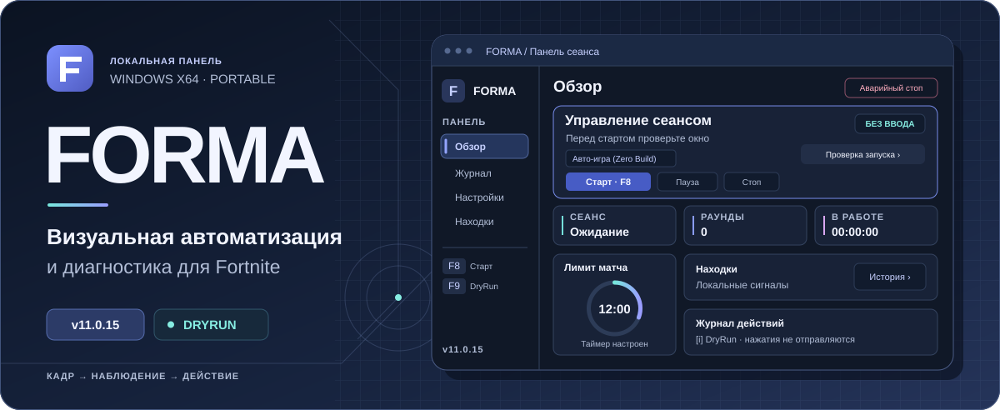

# FORMA

[](https://github.com/Doxaiz/Fortnite-test-bot/releases/latest)

**Переносимая панель для Fortnite.** FORMA анализирует пиксели окна, показывает, что удалось распознать, и позволяет проверить сценарий в **DryRun** — без отправки клавиш и кликов. Программа не читает память игры и не внедряет в неё код.

[**↓ Скачать FORMA v11.0.15 · Windows x64 · ZIP**](https://github.com/Doxaiz/Fortnite-test-bot/releases/download/v11.0.15/FORMA-v11.0.15-windows-x64.zip) · [SHA256SUMS.txt](https://github.com/Doxaiz/Fortnite-test-bot/releases/download/v11.0.15/SHA256SUMS.txt) · [Страница релиза](https://github.com/Doxaiz/Fortnite-test-bot/releases/latest)

[Первый запуск](#первый-запуск) · [Что нового](#что-нового-в-v11015) · [Руководство](docs/guide.md) · [Диагностика](#если-что-то-не-работает)

*На баннере — схема нового «Обзора», не скриншот игры. FORMA — экспериментальный проект, не продукт Epic. Автоматизация может нарушать правила Fortnite и привести к санкциям.*

## Первый запуск

1. **Скачайте ZIP из Assets**, а не архив `Source code`. В PowerShell из папки загрузки проверьте сумму:
   ```powershell
   Get-FileHash -LiteralPath .\FORMA-v11.0.15-windows-x64.zip -Algorithm SHA256
   ```
   Сравните `Hash` со строкой для этого ZIP в `SHA256SUMS.txt`. Если значения различаются, не запускайте EXE.
2. **Распакуйте архив** в отдельную папку с правом записи и откройте `FORMA.exe`. Установщик, отдельный AutoHotkey и Rust не нужны. Оставьте `forma_pixels.dll` рядом с EXE: без неё FORMA использует резервный сканер AutoHotkey.
3. На **«Обзоре»** откройте **«Проверка запуска»**. Сверьте версию, убедитесь, что включён **DryRun · без нажатий**, и проверьте статус окна. Если игра закрыта, статус «окно не найдено» нормален. В новой папке сеанс сам не стартует.
4. Для проверки захвата используйте оконный режим без рамки и **F7**. Затем можно проверить выбранный режим с **F8** в DryRun. **Esc** — аварийный стоп, **F1** — панель/трей. Это клавиши по умолчанию; активное назначение видно в меню FORMA.

**Обновляете FORMA?** Закройте старую версию через «Выход» в трее, распакуйте новую отдельно и [перенесите профиль и локальные данные](docs/guide.md#обновление-с-сохранением-данных) из резервной копии. Не запускайте EXE прямо из ZIP.

## Что нового в v11.0.15

| Раздел | Изменение |
| --- | --- |
| **Звуковой ориентир** | Для подхода по золотой группе нужны два свежих согласованных замера с HUD. Разные направления не дают команду W, а краткое мерцание не перезапускает паузу. Плашка E подтверждается независимо. |
| **Красная метка** | Поворот и Space требуют свежего кадра с HUD. Интервал между прыжками проверяется до остановки: отклонённая по интервалу реакция не прерывает W. |
| **Обход препятствия** | При отсутствии видимого продвижения патруль выбирает подтверждённую боковую полосу. После шага сравнивает новые кадры при W и пробует другой бок только при свежем подтверждении. |
| **DryRun** | Отчёт пары `Ctrl+Shift+F5` различает конфликт направлений, пустой замер и пропуск скана. Цветовая группа не определяет этаж, проходимость или наличие сундука. |

FORMA поддерживает «Авто-игру», «AFK-очередь», «Анти-АФК» и «AFK XP». «Находки» — местные сигналы FORMA, **не состояние инвентаря Epic**. [Подробнее о режимах, панели и настройках](docs/guide.md).

## Если что-то не работает

| Симптом | Что сохранить |
| --- | --- |
| FORMA не стартует | Сводку из **«Проверки запуска»** и ближайшие строки `run.log`. Если панель не открылась — текст сообщения Windows. |
| Свечение, движение или плашка распознаются неверно | В работающем DryRun нажмите **Ctrl+Shift+F5**: `previous.bmp`, `current.bmp`, `report.txt`. Для отдельной видимой плашки — **Ctrl+F5** и ближайшие строки журнала. |
| Захват запаздывает | Нажмите **F7** после 20–30 секунд DryRun и сохраните строки `[capture-stats]` и `[scan-stats]`. |

Проверьте кадры и журнал на личные данные перед отправкой. [Как разобрать захват](docs/window-capture.md) · [Как устроен подход](docs/ground-navigation.md) · [Как проверяется плашка E](docs/prompt-scan.md).

## Проверки и исходники

[Windows CI](https://github.com/Doxaiz/Fortnite-test-bot/actions/workflows/portable.yml) запускает 49 групп сценариев на синтетических кадрах, 26 сценариев с двумя Windows-окнами и тесты панели с Rust DLL и без неё. Запускается `FORMA.exe` из готового ZIP: чистый профиль, обновление, отсутствующая и повреждённая DLL. **Живой матч не проверялся**: тесты не доказывают доставку ввода в Fortnite или открытие сундука.

[Сборка EXE и локальные тесты](docs/guide.md#сборка-переносимого-exe) · [Выпуск релиза](docs/releasing.md) · [Лицензия MIT](LICENSE). Исходники встроенного AutoHotkey v2.0.18 (GPLv2) приложены к релизу отдельным ZIP.
